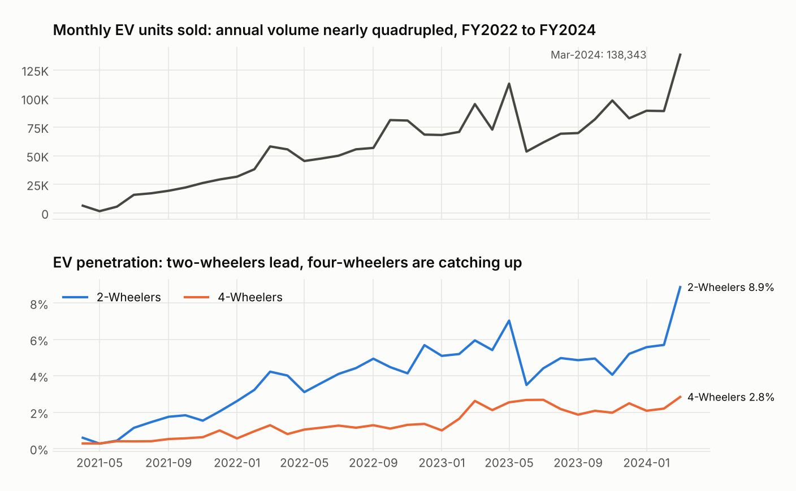
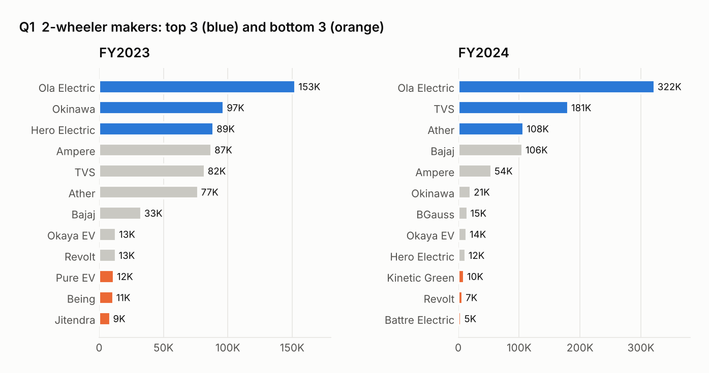
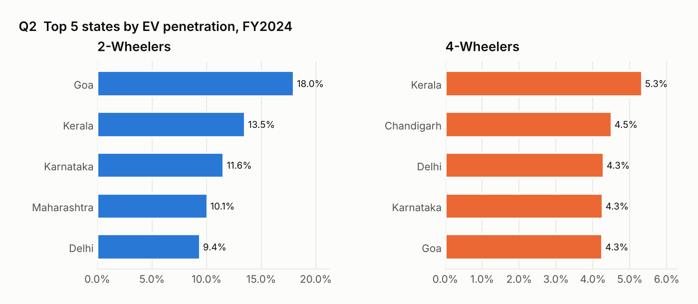
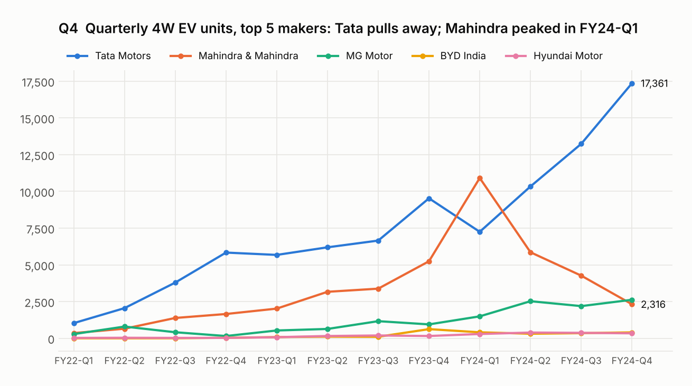
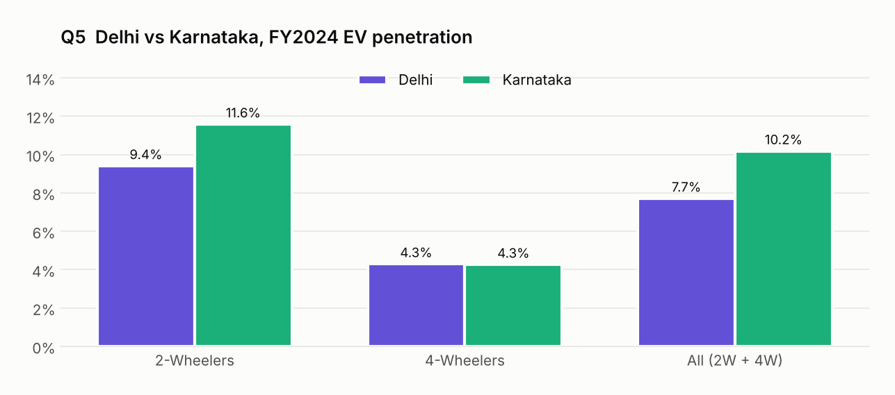
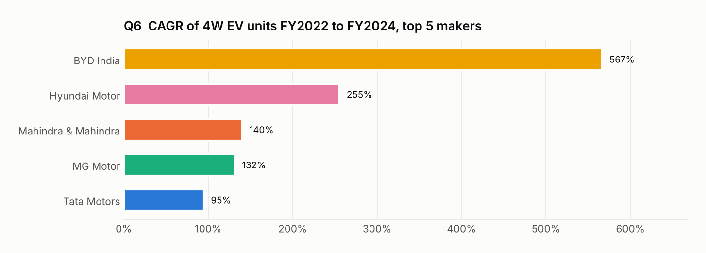
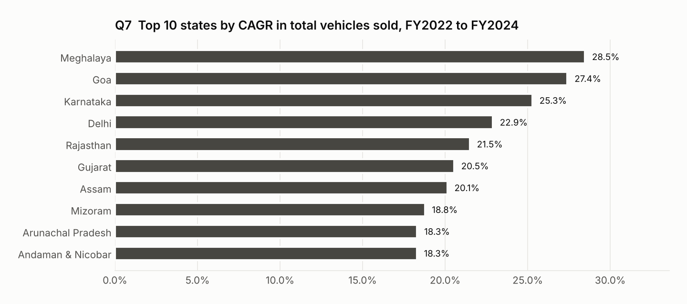
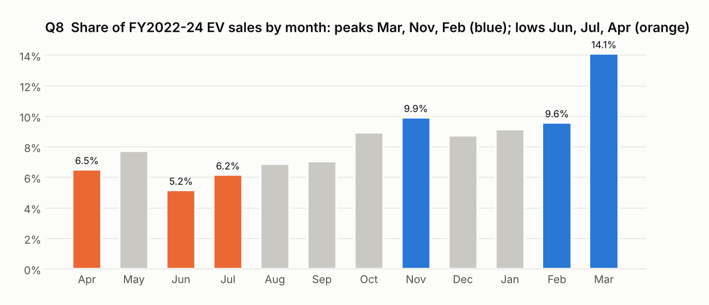
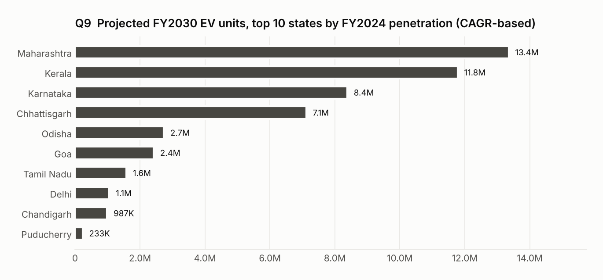
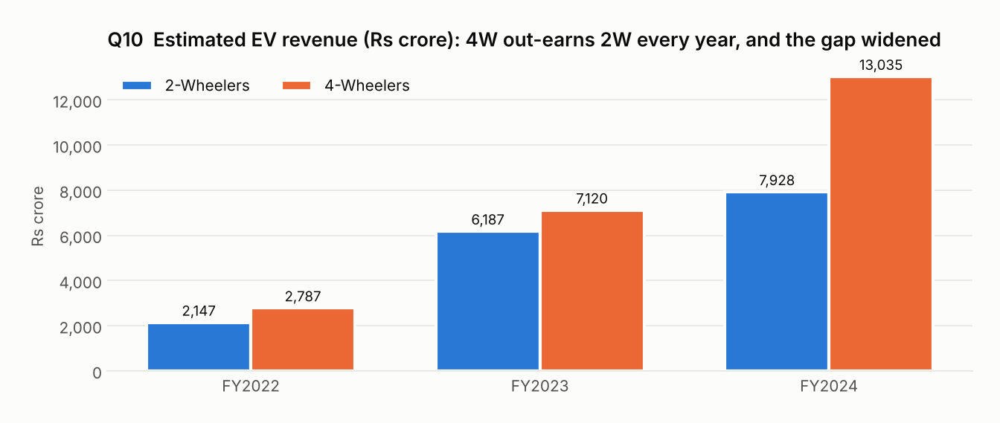

# India EV Market Study: Dashboard

AtliQ Motors India market study, FY2022 to FY2024 (fiscal year = April to March). Source: Vahan registrations, cleaned with `scripts/clean_data.py`. Interactive version: `powerbi/EV_Market_Study.pbip` (see [POWERBI_GUIDE.md](POWERBI_GUIDE.md)).

| Fiscal year | EV units | All vehicles | EV penetration |
|---|---|---|---|
| FY2022 | 271,150 | 16,421,824 | 1.65% |
| FY2023 | 775,368 | 19,621,179 | 3.95% |
| FY2024 | 1,019,593 | 21,190,131 | 4.81% |

## Q1. Top 3 and bottom 3 two-wheeler makers

| Year | Top 3 (high to low) | Bottom 3 (low to high) |
|---|---|---|
| FY2023 | Ola Electric, Okinawa, Hero Electric | Jitendra, Being, Pure EV |
| FY2024 | Ola Electric, TVS, Ather | Battre Electric, Revolt, Kinetic Green |

'Others' excluded. Ola Electric leads both years; TVS and Ather replaced Okinawa and Hero Electric in FY2024.

## Q2. Top 5 states by EV penetration, FY2024

| Rank | 2W state | 2W penetration | 4W state | 4W penetration |
|---|---|---|---|---|
| 1 | Goa | 18.0% | Kerala | 5.3% |
| 2 | Kerala | 13.5% | Chandigarh | 4.5% |
| 3 | Karnataka | 11.6% | Delhi | 4.3% |
| 4 | Maharashtra | 10.1% | Karnataka | 4.3% |
| 5 | Delhi | 9.4% | Goa | 4.3% |

## Q3. States with declining penetration, FY2022 to FY2024

No state declined on a combined 2W + 4W basis. Within one category, two very small markets slipped: **Ladakh 2W** (4.48% to 4.06%) and **Andaman & Nicobar 4W** (1.88% to 0.77%). Their monthly volumes are in the hundreds, so treat this as noise rather than a trend.

## Q4. Quarterly trend, top 5 four-wheeler makers

## Q5. Delhi vs Karnataka, FY2024

| Category | Delhi EV units | Delhi penetration | Karnataka EV units | Karnataka penetration |
|---|---|---|---|---|
| 2-Wheelers | 38,094 | 9.4% | 148,111 | 11.6% |
| 4-Wheelers | 8,630 | 4.3% | 12,878 | 4.3% |
| All (2W + 4W) | 46,724 | 7.7% | 160,989 | 10.2% |

Karnataka sells 3.4x Delhi's EV volume and leads on 2W penetration; 4W penetration is level.

## Q6. CAGR of 4W units, top 5 makers, FY2022 to FY2024

| Maker | FY2022 units | FY2024 units | CAGR |
|---|---|---|---|
| BYD India | 33 | 1,466 | 566.5% |
| Hyundai Motor | 110 | 1,390 | 255.5% |
| Mahindra & Mahindra | 4,042 | 23,346 | 140.3% |
| MG Motor | 1,647 | 8,829 | 131.5% |
| Tata Motors | 12,708 | 48,181 | 94.7% |

## Q7. Top 10 states by CAGR in total vehicles sold

Odisha's FY2024 lacks March-2024 in the source data, so its CAGR is understated.

## Q8. Peak and low months

Peak: **Mar, Nov, Feb** (fiscal year-end buying, festive season). Low: **Jun, Jul, Apr** (start of the fiscal year; FY2022 was also hit by the COVID-19 second wave).

## Q9. Projected FY2030 EV sales, top 10 states by penetration

| State | Penetration FY2024 | EV units FY2024 | CAGR FY22-24 | Projected FY2030 |
|---|---|---|---|---|
| Goa | 13.8% | 10,799 | 146% | 2,419,574 |
| Kerala | 11.4% | 73,938 | 133% | 11,779,401 |
| Karnataka | 10.2% | 160,989 | 93% | 8,383,406 |
| Maharashtra | 8.6% | 197,169 | 102% | 13,351,146 |
| Delhi | 7.7% | 46,724 | 68% | 1,054,259 |
| Chandigarh | 6.4% | 2,877 | 165% | 986,811 |
| Odisha | 6.3% | 39,118 | 103% | 2,732,814 |
| Chhattisgarh | 5.7% | 28,540 | 151% | 7,118,219 |
| Tamil Nadu | 5.5% | 94,314 | 60% | 1,579,547 |
| Puducherry | 5.4% | 3,098 | 105% | 232,936 |

Projection = FY2024 units x (1 + CAGR)^6. Early-adoption growth rates will not hold for six more years, so read this as an upper bound.

## Q10. Estimated revenue growth

| Category | FY2022 (Rs cr) | FY2023 (Rs cr) | FY2024 (Rs cr) | Growth FY22-24 | Growth FY23-24 |
|---|---|---|---|---|---|
| 2-Wheelers | 2,147 | 6,187 | 7,928 | 269% | 28% |
| 4-Wheelers | 2,787 | 7,120 | 13,035 | 368% | 83% |

Assumed average price: 2W Rs 85,000, 4W Rs 1,500,000.

---
Full tables: [analysis/PRIMARY_ANSWERS.md](analysis/PRIMARY_ANSWERS.md) · Cleaning log: [reports/DATA_CLEANING_REPORT.md](reports/DATA_CLEANING_REPORT.md)
