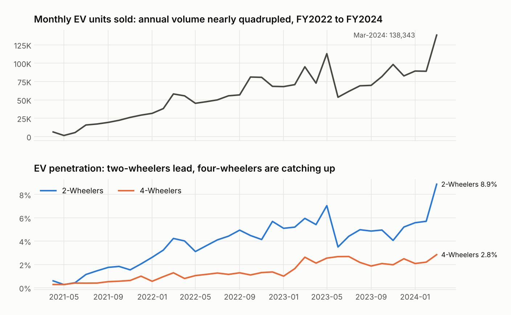

# India EV Market Study (AtliQ Motors)

Market study of India's electric two-wheeler and four-wheeler market, FY2022–FY2024,
for AtliQ Motors' India entry decision (Codebasics Resume Project Challenge).
Data source: Vahan (Ministry of Road Transport & Highways) monthly registrations.

**Pipeline:** raw CSVs → Python cleaning → star-schema CSVs → Power BI dashboard.

- **View the dashboard in your browser:** [DASHBOARD.md](DASHBOARD.md) (charts + answers to Q1–Q10)
- **Open it in Power BI:** download the repo, open `powerbi/EV_Market_Study.pbip`, click Refresh.
  Data loads from this repo, no setup. Details: [POWERBI_GUIDE.md](POWERBI_GUIDE.md)



## Headline numbers (cleaned data)

| Fiscal year | EV units sold | Total vehicles sold | EV penetration |
|---|---|---|---|
| FY2022 | 271,150 | 16,421,824 | 1.65% |
| FY2023 | 775,368 | 19,621,179 | 3.95% |
| FY2024 | 1,019,593 | 21,190,131 | 4.81% |

Full answers to the 10 primary questions: [`analysis/PRIMARY_ANSWERS.md`](analysis/PRIMARY_ANSWERS.md)

## Repository layout

```
data/raw/            original files as received (never edited)
data/cleaned/        Power BI-ready star schema (6 CSVs)
scripts/
  clean_data.py      cleaning + data-quality checks
  analysis.py        answers to the 10 primary questions
  build_dashboard.py charts + DASHBOARD.md (renders on GitHub)
  build_powerbi.py   generates the Power BI project + measures.dax
reports/             DATA_CLEANING_REPORT.md, data_quality_log.csv
analysis/            PRIMARY_ANSWERS.md + one CSV per question
dashboard/           chart images used by DASHBOARD.md
powerbi/             EV_Market_Study.pbip (5-page dashboard), measures.dax
DASHBOARD.md         the dashboard, viewable on GitHub
POWERBI_GUIDE.md     how to open / build the Power BI dashboard
RUN_ON_MAC.md        terminal commands (Mac / VS Code)
```

## Run it

```bash
python3 -m venv .venv && source .venv/bin/activate   # Windows: .venv\Scripts\activate
pip install -r requirements.txt
python scripts/clean_data.py
python scripts/analysis.py
python scripts/build_dashboard.py
python scripts/build_powerbi.py
```

## What the cleaning fixed

| Issue | Fix |
|---|---|
| Same UT spelled two ways ("Andaman & Nicobar Island" / "Andaman & Nicobar") | Unified to one name |
| Kerala 4W Jan-2024: EV sold 734 > total sold 164 | Total imputed from adjacent months (13,046), flagged `is_imputed` |
| Maker typo "Mercedes -Benz AG" and ALL-CAPS 2W maker names | One clean display name per maker |
| Dates stored as text `DD-MMM-YY` | ISO dates (`yyyy-mm-dd`) so Power BI parses them in any locale |
| Byte-order mark in the state file header | Stripped |
| Odisha Mar-2024 and Andaman 4W Jun-2021 missing in source | Left missing (not invented), documented |

Kept as genuine after checking: COVID-19 dip in May–June 2021; Chandigarh's 55% 2W
penetration in Mar-2023 (petrol two-wheeler registrations were halted there under its
EV policy). EV totals in the state file and the maker file match exactly for all 72
month × category pairs. Telangana is not in the source data.

Full log: [`reports/DATA_CLEANING_REPORT.md`](reports/DATA_CLEANING_REPORT.md)

## Data model

```
dim_date ─────────────┬──< fact_state_sales >── dim_state
                      └──< fact_maker_sales >── dim_maker
dim_vehicle_category ─┴── (filters both facts)
```

## Author

Shaswat Mohanty — [LinkedIn](https://www.linkedin.com/in/shaswat-m-b864372a9/)
